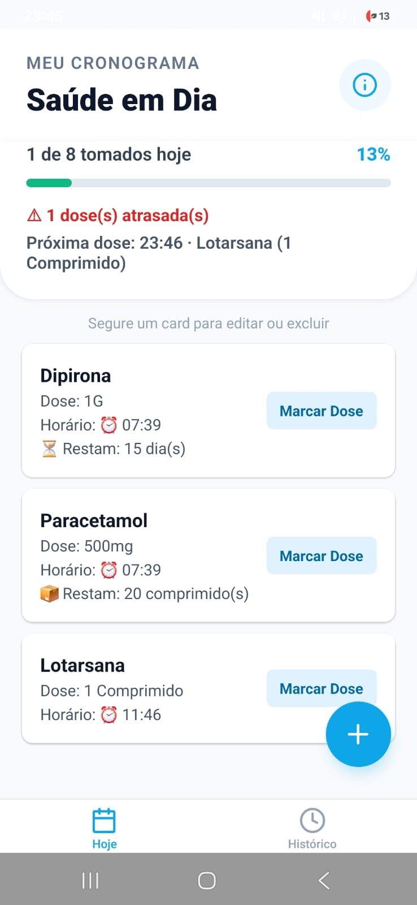
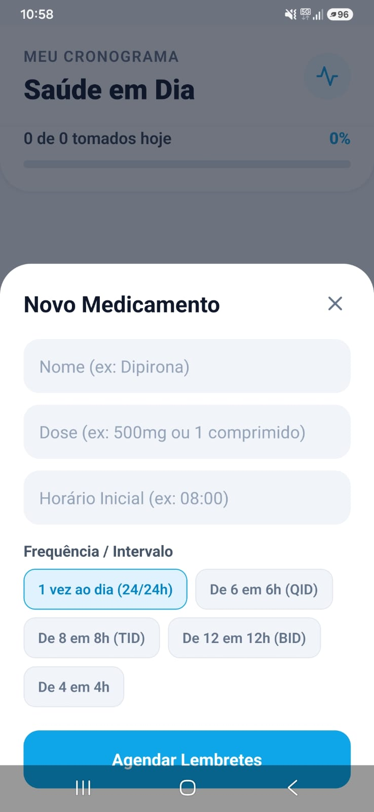
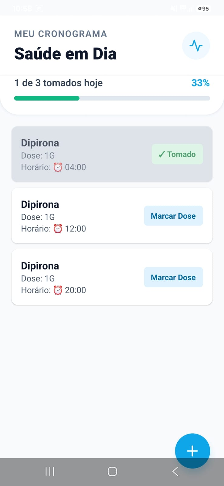
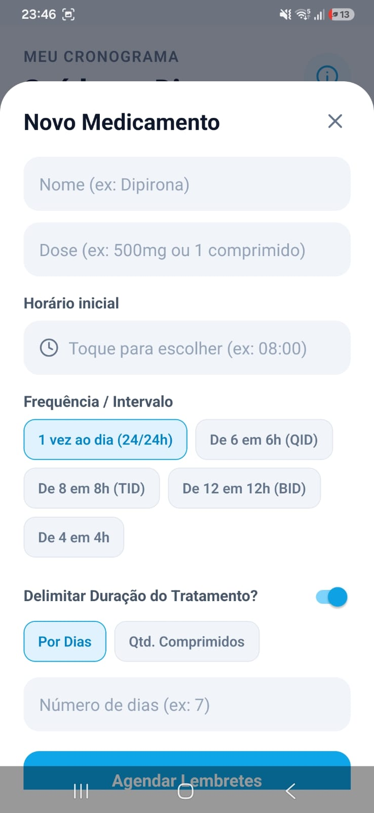

# 💊 Saúde em Dia - Aplicativo de Gestão e Lembrete de Medicamentos
Aplicativo mobile desenvolvido em React Native e Expo com foco em saúde e bem-estar, projetado para auxiliar usuários no controle rigoroso de tratamentos médicos, horários de posologia e adesão a medicamentos.

> ⚠️ **Aviso:** o app é um lembrete de apoio e **não substitui a orientação de um médico ou farmacêutico**. Siga sempre a prescrição médica.

# 🚀 Principais Funcionalidades
Cadastro Inteligente de Posologia: Registro de nomes, doses e horários iniciais com seletor de horário nativo.

Cálculo Automático de Frequência: Suporte para intervalos médicos padrão (Dose única, 4 em 4h, 6 em 6h, 8 em 8h, 12 em 12h), gerando os horários do dia automaticamente.

Notificações Nativas: Integração com o sistema operacional para envio de lembretes e alarmes nos horários programados, com o botão **"Tomei ✓"** direto na notificação.

Controle de Progresso Diário: Dashboard dinâmico com barra de progresso em tempo real baseada nos medicamentos já tomados no dia, **próxima dose** e destaque de **doses atrasadas**.

Duração do Tratamento: Tratamentos por número de dias (encerram sozinhos, cancelando os lembretes) ou por quantidade de comprimidos, com desconto automático do estoque, **aviso de estoque baixo** (restam até 3 dias) e aviso de estoque esgotado.

Edição e Exclusão: Segure o card de um medicamento para editar ou excluir o tratamento inteiro. Os lembretes são reagendados ou cancelados automaticamente.

Histórico Diário: Um registro por dia com taxa de conclusão, detalhe de cada dose (tomada ou não) e adesão dos últimos 7 dias.

Persistência Local de Dados: Armazenamento seguro e offline utilizando AsyncStorage, garantindo que os dados não se percam ao fechar o app.

Interface Moderna & Responsiva: Design limpo inspirado em padrões de UI/UX modernos, com suporte a modais fluidos, feedback tátil e paleta de cores focada em saúde.

# 🛠️ Tecnologias Utilizadas
React Native / Expo (Framework principal)

JavaScript (ES6+)

React Hooks (useState, useEffect, useCallback, useMemo, useRef)

React Navigation (abas "Hoje" e "Histórico")

AsyncStorage (Persistência local)

Expo Notifications (Gestão de alarmes nativos e ação "Tomei")

DateTimePicker (@react-native-community/datetimepicker)

Vector Icons (@expo/vector-icons)

EAS Build (Compilação e geração de APK para Android)

# ⚙️ Como os Dados São Guardados
| Chave | Conteúdo |
|-------|----------|
| `@medicamentos_app` | dia atual + lista de doses (uma por horário) |
| `@medicamentos_historico` | um registro por dia anterior (até 90 dias) |

Cada dose pertence a um tratamento (`grupoId`). Na virada do dia, o dia anterior é arquivado no histórico e as doses voltam a "não tomada".

# ⚠️ Limitações Conhecidas
O estoque considera 1 comprimido por dose tomada.

O dia só é arquivado no histórico quando o app é aberto ou volta ao primeiro plano.

Os lembretes dependem das permissões de notificação e das otimizações de bateria do aparelho.

# 📱 Capturas de Tela:
      
